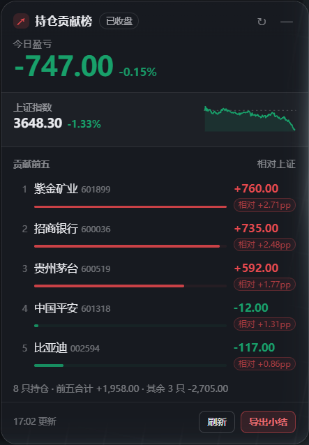
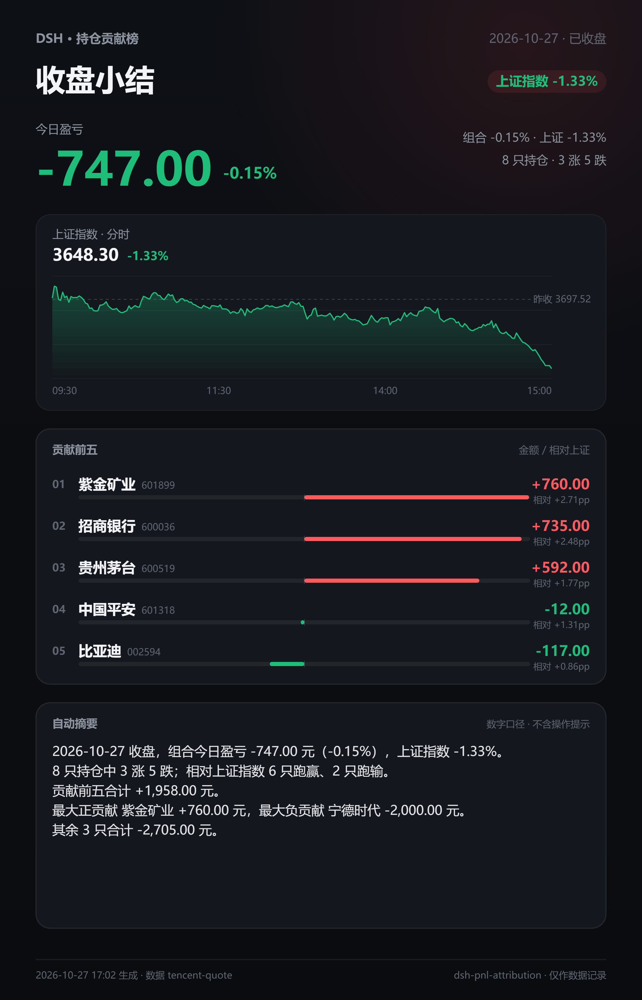

# dsh-pnl-attribution

[](https://github.com/dingchenhui0618-arch/dsh-pnl-attribution/actions/workflows/ci.yml)
[](LICENSE)

给 DeepSeek Harness 的 **A 股持仓贡献卡**：不只知道今天赚了多少，还知道**这些钱是哪几只票赚的**；收盘后一键导出可发群里的 PNG 收盘小结。

> 灵感来自 [pm25000/dsh-ths-holdings](https://github.com/pm25000/dsh-ths-holdings)（同花顺投资账本悬浮盈亏卡）。本项目是**独立实现**：没有 fork、没有 clone 后改、没有复制它的代码。原仓库是 MIT，思路可以借鉴，代码没有搬运。具体差异见文末。

## 截图

悬浮卡（构建产物 `lib/client.js` 在无头 Chrome 中加载，真实演示持仓与真实行情渲染）：



收盘后导出的 PNG 长图（同一份数据，1080×1680 @2x）：



## 它解决什么

原版 README 的功能表停在「今日盈亏 + 上证指数 + 分时图」——回答的是“总共赚了多少”。做产品文档和汇报时，下一个问题一定是“哪些票贡献的、谁跑赢了指数、有没有一张能直接发出去的图”。

这张卡把三件事放进同一个浮层：

- **今日盈亏**：金额与组合涨跌幅，和上证指数并排。
- **贡献前五**：逐只计算今日盈亏贡献金额，按金额降序取前五，同时标出相对上证的强弱（个股涨跌幅 − 上证涨跌幅，单位 pp）。
- **收盘小结 PNG**：15:00 后一键导出，含贡献榜、上证分时图和一段**只陈述数字**的自动摘要。

## 与灵感来源的差异

| 能力 | pm25000/dsh-ths-holdings（按公开 README） | dsh-pnl-attribution |
| --- | --- | --- |
| 今日盈亏 / 上证 / 分时 | 有 | 有 |
| 逐只贡献金额 + 相对指数强弱 + 前五排序 | 无 | **有** |
| 收盘后导出 PNG 小结 | 无 | **有**（贡献榜 + 分时 + 摘要） |
| 自动摘要 | 无 | **有**，只给数字，不给买卖建议 |
| 持仓来源 | 同花顺投资账本 Cookie 会话 | 本地 `holdings.csv` / `holdings.json`，**不读任何 Cookie** |
| 凭据 | 保存同花顺 Cookie | 不接触任何凭据 |
| 设置面板 / 自动获取 Cookie | 有 | 无（本项目刻意不做券商会话） |

差异的取舍：原版强在「自动同步真实持仓」，为此需要登录态；本项目强在「归因 + 可交付」，代价是持仓要你从券商/同花顺导出后整理成三列。两条路解决的不是同一个问题，本项目没有假装能替它自动登录。

## 安装

尚未发布 npm 包，直接从 GitHub 装：

```sh
dsh plugin --profile <你的 profile> add github:dingchenhui0618-arch/dsh-pnl-attribution
```

本地开发目录也可以直接装：

```sh
dsh plugin --profile <你的 profile> add D:\Projects\dsh-pnl-attribution
```

装好后重启 DSH（或刷新 Web 页面），右下角出现「持仓贡献榜」浮卡。桌面端在插件页安装时，profile 由应用自己管理。

要求 DSH `0.2.x`（`engines.dsh` 为 `>=0.2.1-rc.2 <0.3.0`）。

## 配置持仓

默认读取：

```
~/.dsh/pnl-attribution/holdings.csv
```

格式（`cost` 可省略；`sh`/`sz`/`bj` 前缀也可省略，六位代码会按交易所规则推断）：

```csv
code,name,shares,cost
600519,贵州茅台,100,1320.00
300750,宁德时代,400,245.00
601318,中国平安,1200,48.20
```

也接受 JSON：数组，或 `{ "holdings": [...] }`，字段 `code|symbol`、`name`、`shares`、`cost`。仓库里的 [`examples/holdings.demo.csv`](examples/holdings.demo.csv) 是一份演示持仓（虚构股数，只用公开代码），复制到上面的路径即可先看到效果。

要换路径或刷新间隔，在 profile 的 `cordis.patch.yml` 里给这一行加 `config`：

```yaml
- insert:
    - id: dsh-pnl-attribution
      name: dsh-pnl-attribution
      config:
        holdingsPath: D:\money\holdings.csv
        refreshMs: 20000
```

`refreshMs` 会被限制在 5 秒到 10 分钟之间；改持仓文件后凭 mtime 自动失效缓存，也可以点卡片上的「刷新」。

## 数据从哪来

- **行情**：腾讯公开行情接口（`qt.gtimg.cn` 快照 + `web.ifzq.gtimg.cn` 分时）。批量请求一次拿全部持仓和上证指数，卡片每 20 秒轮询。
- **指数**：上证指数 `sh000001`，分时序列就是导出图里的那条线。
- **持仓**：只读你指定的本地文件。
- **没有**：券商登录、Cookie、账号、token、交易接口。插件不会写入你的持仓文件。

行情是公开接口，可能延迟、限流或在非交易日停更；卡片会显示数据时间，抓取失败时保留上一次成功快照并标记「缓存」。

## 贡献怎么算

对每只持仓：

```
单只今日盈亏   = 股数 × (现价 − 昨收)
单只涨跌幅     = 现价 / 昨收 − 1
相对上证强弱   = 单只涨跌幅 − 上证涨跌幅        （单位 pp）
前五           = 按单只今日盈亏降序取 5 只
```

组合今日盈亏 = 所有有行情的持仓之和；组合涨跌幅 = 组合盈亏 / 全部持仓的昨收市值。`cost`（成本价）只用于记录，不参与今日盈亏计算。没有行情的持仓会被标记为缺失并排除，不会当成 0 元。

## 收盘小结 PNG

- 15:00（Asia/Shanghai）后按钮才可用；盘前/盘中导出按钮是禁用的，避免把半天的数字当收盘结论。
- 图片 1080×1680，2 倍分辨率渲染，含：日期与收盘状态、今日盈亏、上证分时图、贡献前五（金额 + 相对强弱 + 零轴条）、自动摘要、数据时间。
- 摘要只陈述数字：组合合计、涨跌家数、跑赢/跑输家数、前五合计、最大正/负贡献、其余持仓合计。**不含任何买卖建议**，也没有「建议/买入/卖出/加仓/减仓」这类词（测试里有一条断言专门扫这些词）。
- 导出在浏览器本地完成，不经过服务器，不产生第二次行情请求。

## 隐私与边界

- 只读 `holdingsPath` 指向的文件；不碰 `~/.dsh` 里的凭据、Cookie 或其他配置。
- 卡片状态由本机 DSH Web 服务在 `/dsh-pnl-attribution/state` 提供；任何能访问你的 DSH Web 界面的人都能看到这张卡，和看到对话本身一样。不要把 Web 端口暴露到不可信网络。
- 不是交易系统，不接券商，不下单，不构成投资建议。
- 目前只支持 A 股人民币持仓（沪深北六位代码）；港股、美股、两融、期权不在范围内。
- 非交易日显示的是上一交易日的收盘数据；周末导出的是最近一次收盘快照，日期会写在图上。

## 开发

```sh
node scripts/build.mjs   # 零依赖构建，产出 lib/
node --test              # 43 个测试
```

`lib/` 是 `src/` 的构建产物，两者都入库；CI 会在 ubuntu/windows × node 22/24 上重新 build，并检查 `lib/` 与 `src/` 一致。

测试分三组：

- `core`：CSV/JSON 解析、交易所推断、上海市场时钟、贡献/相对强弱/前五、摘要措辞（含“无建议词”断言）、快照导出闸门。
- `quotes`：GBK 解码、腾讯字段映射、分时序列、批量分片、HTTP 失败与缺指数。
- `host`：真实 `apply()` + stub fetch，钉住状态契约、缓存、mtime 失效、失败后 stale、缺文件引导、卸载拆路由。

## License

MIT。灵感与产品思路来自 [pm25000/dsh-ths-holdings](https://github.com/pm25000/dsh-ths-holdings)（MIT），未复用其代码；本仓库的实现、测试与截图均为独立产出。
